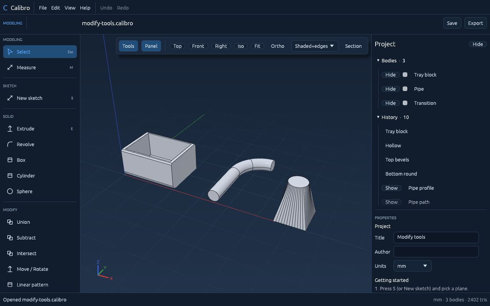

# Calibro

**Calibro** is an open-source, precision 3D CAD application written in Rust. It follows the
modelling workflow popularised by Shapr3D — sketch, constrain, extrude, edit the history — and
runs on the desktop (Windows, macOS, Linux) and in the browser.



> Calibro is an independent project. It is not affiliated with, endorsed by, or derived from
> Shapr3D's code, assets or file format.

## What works today (Stage 1)

- **Sketching** on standard planes or on flat faces: lines, rectangles, circles, arcs,
  polygons, construction geometry, snapping and automatic horizontal/vertical constraints.
- **Constraints & dimensions**: coincident, horizontal, vertical, parallel, perpendicular,
  tangent, equal, concentric, midpoint, symmetric, fixed, point-on-curve, distance,
  horizontal/vertical distance, length, angle, radius, diameter — solved by Calibro's own
  solver, with fully/under/over-defined feedback.
- **Solid modelling** on an exact B-rep kernel ([truck](https://github.com/ricosjp/truck)):
  extrude (new body / join / cut / intersect, symmetric, drag handle), revolve, box,
  cylinder, sphere, union/subtract/intersect, move/rotate/scale, linear and circular
  patterns, mirror.
- **Parametric history**: edit any feature and everything after it rebuilds; failures are
  explained per feature; suppress, roll back, undo/redo.
- **Viewport** (wgpu): shaded + edges, shaded, wireframe, X-ray, materials
  (metallic/roughness), section view, measuring, face/edge/body selection.
- **Files**: native editable `.calibro` projects; export STEP (exact), GLB, OBJ+MTL, STL;
  import STEP/STL/OBJ as reference geometry.

- **Modify**: fillet and chamfer (straight edges), shell, sweep (line/arc paths), loft (two
  profiles) — first versions with limits listed in the tracker.
- **Sketch on a face like Shapr3D**: click a flat face, press **Space** — the camera turns to face it.

Not yet: corner/curved-edge fillets, shell of curved bodies, 2D drawings, IGES/3MF — see
[`docs/FEATURE_TRACKER.md`](docs/FEATURE_TRACKER.md) for the full, honest status of every feature.

## Quick start

```bash
# 1. install Rust from https://www.rust-lang.org/tools/install
# 2. in this folder:
cargo run --release -p calibro
```

New to GitHub or Rust? Read **[docs/BEGINNER_GUIDE.md](docs/BEGINNER_GUIDE.md)** — it
covers uploading, building, running, publishing and updating, step by step.

Browser version (after enabling GitHub Pages): `https://YOUR-USERNAME.github.io/calibro/`.
Locally: `rustup target add wasm32-unknown-unknown && cargo install --locked trunk && cd app && trunk serve`.

Example projects: open `examples/showcase.calibro` or `examples/bracket.calibro`
(`File → Open`, or pass the path: `cargo run --release -p calibro -- examples/showcase.calibro`).

## Documentation

| Document | Contents |
|---|---|
| [docs/BEGINNER_GUIDE.md](docs/BEGINNER_GUIDE.md) | Install, upload to GitHub, build, run, publish, update, troubleshooting |
| [docs/FEATURE_TRACKER.md](docs/FEATURE_TRACKER.md) | Master feature tracker: full scope, status, tests, next steps |
| [docs/RESEARCH.md](docs/RESEARCH.md) | Shapr3D feature research, kernel comparison, rendering/UI/platform decisions, licensing |
| [docs/ARCHITECTURE.md](docs/ARCHITECTURE.md) | Crates, data flow, parametric model, `.calibro` file format |
| [docs/TEST_REPORT.md](docs/TEST_REPORT.md) | Commands run, results, independent verification, known issues |

## Project layout

```
crates/calibro-sketch    sketch model, constraint solver, region detection
crates/calibro-kernel    B-rep operations on the truck kernel, tessellation
crates/calibro-core      feature history, recompute engine, undo/redo
crates/calibro-project   native .calibro format
crates/calibro-io        STEP / STL / OBJ / GLB
app/                     the application (egui UI + wgpu renderer), desktop and web
```

## Licence

Apache-2.0 — see [LICENSE](LICENSE). Dependencies are MIT and/or Apache-2.0 licensed
(details in [docs/RESEARCH.md](docs/RESEARCH.md#7-licensing-not-legal-advice)).
