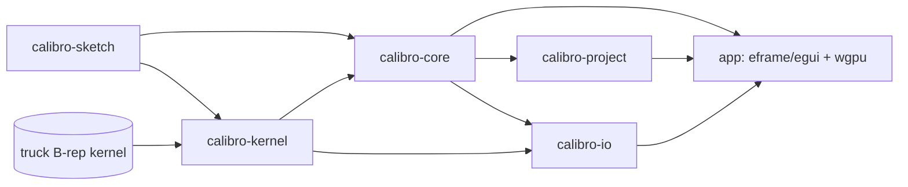
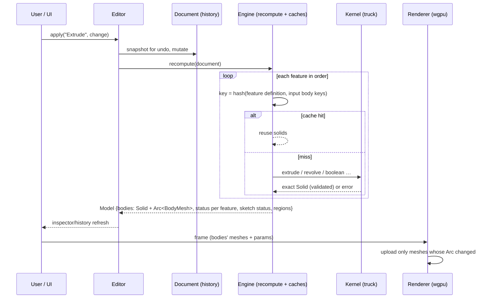

# Calibro — Architecture

## Workspace layout

```
calibro/
├── Cargo.toml                  workspace definition, shared dependency versions
├── crates/
│   ├── calibro-sketch/         2D sketch model, constraint solver, region detection (pure Rust, only serde)
│   ├── calibro-kernel/         adapter over the truck B-rep kernel: extrude, revolve, booleans,
│   │                           primitives, transforms, mirror, tessellation, validation
│   ├── calibro-core/           Document (feature history), recompute Engine (+caches), Editor (undo/redo, dirty)
│   ├── calibro-project/        native .calibro file format (ZIP container, versioning, safe save)
│   └── calibro-io/             STEP / STL / OBJ / GLB import & export
├── app/                        the application (eframe + egui UI, wgpu renderer), desktop + web entry points
│   ├── src/app.rs              state, commands, file operations, shortcuts, dialogs
│   ├── src/panels.rs           menu, tool palette, bodies, history, inspector, status bar
│   ├── src/viewport.rs         navigation, picking, sketch tools, drag handles, overlays, frame assembly
│   ├── src/renderer.rs         wgpu pipelines and GPU buffers (+ headless rendering tests)
│   ├── src/viewport.wgsl       shaders
│   ├── src/camera.rs           orbit camera and projections
│   ├── src/picking.rs          ray/triangle and screen-space edge picking
│   ├── src/files.rs            native dialogs vs. browser upload/download
│   ├── index.html, Trunk.toml  browser build
├── docs/                       research, tracker, guide, test report, this file
└── .github/workflows/          CI, GitHub Pages deployment, desktop releases
```

Dependency direction (no cycles, UI-free core):



## Data flow



Three representations are kept apart (spec §6.3):
1. **Authoritative geometry** — `truck::Solid` per body (exact NURBS/B-rep).
2. **Display mesh** — `BodyMesh` (positions, normals, per-vertex B-rep face id, edge polylines,
   planar face frames), produced by tessellation and cached by content hash.
3. **Interaction data** — picking uses display triangles but returns B-rep face ids; "sketch on
   face" reads the exact plane of that B-rep face, not the triangles.

## Parametric model

- A `Document` is an ordered list of `Feature`s (`Sketch`, `Extrude`, `Revolve`, `Primitive`,
  `Boolean`, `Transform`, `LinearPattern`, `CircularPattern`, `Mirror`, `ImportedSolid`,
  `ImportedMesh`), plus body appearance, camera, units and metadata.
- Bodies are identified by `BodyId {feature, index}` — the feature that created them. Join/Cut/
  Boolean/Transform keep the target's id, so later features keep pointing at "the same body".
- Regions of a sketch are referenced by an **interior seed point**, which survives most
  dimension edits better than a region index would.
- `Engine::recompute` evaluates in order; a failing feature records `Failed(reason)` and
  everything consuming its bodies fails with an explanatory message, while unrelated features
  keep working. A rollback marker evaluates only the first *N* features.
- Undo/redo stores whole-document snapshots (documents are small; geometry is never stored).
  Continuous gestures (dragging a value or a point) are merged into one undo step.

## Native file format `.calibro` (format version 1)

ZIP container:

| Entry | Content |
|---|---|
| `mimetype` | `application/vnd.calibro.project` (stored uncompressed, first) |
| `manifest.json` | `{ "format": "calibro-project", "format_version": 1, "app_version": "0.1.0", "document": "document.json", "resources": [...] }` |
| `document.json` | the serialized `Document` (pretty JSON) |
| `resources/<name>` | binary resources: `CMSH` triangle meshes for imported references; JSON B-rep for imported solids |

Rules: newer `format_version` → refused with "update Calibro"; older → `migrate()`; every
listed resource must exist; every sketch is validated (references to existing entities).
Desktop saves write `name.calibro.tmp`, verify it by re-reading, copy the previous file to
`name.calibro.bak`, then rename atomically — a failed save never destroys the last good file.
Geometry is recomputed on open, so files stay small and fully editable.

## Kernel safety

Every kernel call goes through `calibro_kernel::guarded`, which turns a panic inside truck into
an error (native builds). Boolean results are checked with `is_valid_solid` (all shells closed).
For extrusions that join/cut a body from a sketch lying exactly on one of its faces, the engine
retries with the tool extended by `COPLANAR_OVERLAP` (0.2 mm) into the target, because truck
cannot intersect coplanar faces.

## Coordinate conventions

Model units are millimetres, Z is up. Display units (mm, cm, m, in) only affect the UI.
Exports: STL/OBJ in millimetres (OBJ converted to Y-up for Blender/Maya/C4D), GLB in metres
and Y-up (via a root node), STEP in millimetres.
